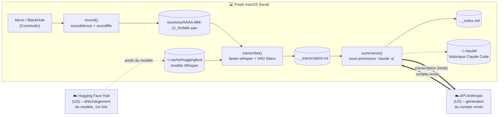

# Architecture de `script/meeting-agent.py`

> Scripts voisins, 100 % locaux et sans Claude : [meeting-whisper](architecture-meeting-whisper.md) · [meeting-whisper-final](architecture-meeting-whisper-final.md)

Outil local de prise de notes de réunion : il enregistre l'audio, le transcrit **sur le poste**, puis fait rédiger un compte rendu par **Claude (Anthropic)** via la CLI Claude Code.

> **En une phrase :** l'audio et la transcription sont produits localement. Seul le **texte de la transcription** quitte le poste, vers Anthropic (États-Unis), au moment du résumé.

---

## Lancer le script

```bash
# Chemin relatif (depuis le dossier local-meeting-transcriber)
cd <DOSSIER_PARENT>/local-meeting-transcriber
python3 ./script/meeting-agent.py --list                                 # liste les micros
python3 ./script/meeting-agent.py --device "MacBook Air Microphone"      # Ctrl+C pour arrêter

# Chemin absolu (depuis n'importe où)
python3 <DOSSIER_PARENT>/local-meeting-transcriber/script/meeting-agent.py --list
python3 <DOSSIER_PARENT>/local-meeting-transcriber/script/meeting-agent.py --device "MacBook Air Microphone"
```

`<DOSSIER_PARENT>` = le chemin du dossier **qui contient** `local-meeting-transcriber` (par exemple `/Users/<ton-utilisateur>/Downloads`). Remplace-le, chevrons compris. Les fichiers sont écrits dans `reunions/` **du dossier courant** : lance le script depuis `local-meeting-transcriber` pour les y retrouver.

---

## 1. Vue d'ensemble



Légende : trait plein = données de la réunion ; trait gras = données de la réunion **sortant du poste** ; pointillé = pas de données de réunion.

---

## 2. Étapes du traitement

| # | Fonction | Ce qu'elle fait | Composants | Où ça s'exécute | Données de réunion envoyées ? |
|---|---|---|---|---|---|
| 1 | `record()` | Capture le périphérique d'entrée choisi (`--device`) en mono 16 kHz jusqu'au Ctrl+C | `sounddevice` (PortAudio → CoreAudio), `soundfile` (libsndfile) | Local | Non |
| 2 | `transcribe()` | Transcrit le `.wav` en français, avec horodatage par segment | `faster-whisper` (moteur CTranslate2), modèle `Systran/faster-whisper-small`, VAD Silero (`silero_vad_v6.onnx`, fourni avec le paquet, exécuté par `onnxruntime`), `av` (décodage) | Local (CPU) | **Non** |
| 3 | `summarize()` | Envoie un prompt + la transcription à `claude -p`, récupère le Markdown | CLI Claude Code (`/opt/homebrew/bin/claude`, v2.1.326) → API Anthropic | **Distant (Anthropic)** | **Oui : la transcription complète** |
| 4 | `main()` | Écrit les fichiers de sortie dans `reunions/` | Python standard | Local | Non |

**Qui traite la transcription ?**
- La **produire** : `faster-whisper`, en local. Aucun appel réseau, sauf le téléchargement initial du modèle.
- La **résumer** : **Anthropic**, via Claude Code. Le compte utilisé est celui connecté à Claude Code (`claude` puis `/status` pour le vérifier). Le script retire `ANTHROPIC_API_KEY` de l'environnement pour forcer l'usage de ce compte et ne pas passer par une clé API.

---

## 3. Inventaire des services externes

| Service | Société / juridiction | Quand | Ce qui est transmis | Données de réunion ? |
|---|---|---|---|---|
| **API Anthropic** (via Claude Code) | Anthropic PBC – 🇺🇸 États-Unis | À **chaque** réunion | Prompt + **transcription intégrale** ; identifiants du compte | **Oui** |
| Télémétrie / rapports d'erreur Claude Code | Anthropic et ses sous-traitants – 🇺🇸 | À chaque lancement de `claude` | Métadonnées d'usage et d'erreurs (pas le contenu, selon la doc Anthropic, à vérifier) | Non, en principe |
| **Hugging Face Hub** (`huggingface.co`, stockage Xet/CDN) | Hugging Face Inc. – 🇺🇸 (siège à New York) | 1er lancement, ou tant que le cache est vide | IP, user-agent, nom du modèle demandé | Non |
| **PyPI** (`pypi.org`, `files.pythonhosted.org`) | Python Software Foundation – 🇺🇸, CDN Fastly | Installation (`pip install`) | IP, liste des paquets | Non |
| **Homebrew** (GitHub) | Communauté / GitHub (Microsoft) – 🇺🇸 | Installation de `claude`, `python`, `blackhole-2ch` | IP, liste des formules | Non |
| npm registry *(si Claude Code installé via npm)* | GitHub / Microsoft – 🇺🇸 | Installation | IP, nom du paquet | Non |

Composants **sans aucun appel réseau** pendant l'exécution : `sounddevice`, `soundfile`, `numpy`, `ctranslate2`, `onnxruntime`, `av`, le VAD Silero, BlackHole (pilote audio local).

À noter : malgré le nom « Whisper », **rien n'est envoyé à OpenAI**. Seuls les poids du modèle (licence MIT), convertis par Systran, sont utilisés, et ils tournent en local.

---

## 4. Données stockées localement

| Emplacement | Contenu | Durée de conservation |
|---|---|---|
| `reunions/*.wav` | Enregistrement audio brut (voix des participants) | Illimitée (aucune purge) |
| `reunions/*_transcription.txt` | Transcription horodatée | Illimitée |
| `reunions/*_notes.md` | Compte rendu généré par Claude | Illimitée |
| `~/.claude/` | Historique des sessions Claude Code, qui peut contenir le prompt et la transcription | Selon la configuration de Claude Code |
| `~/.cache/huggingface/` | Poids du modèle (aucune donnée personnelle) | Jusqu'à suppression manuelle |

Aucun de ces fichiers n'est chiffré par le script. La protection repose sur FileVault et les droits du compte macOS.

---

## 4 bis. Consommation de tokens

Mesures faites avec `claude -p "Réponds juste OK" --output-format json` (Claude Code v2.1.326, le 17/11/2026) :

| Configuration | Tokens de départ (avant la transcription) | Coût au tarif public |
|---|---|---|
| Appel actuel : `claude -p`, modèle par défaut (Opus 5.5) | ~40 000 (instructions et outils de Claude Code) | ~0,15 $ |
| `--model sonnet --tools "" --system-prompt "…"` | ~2 200 | ~0,009 $ |

Pour 1 h de réunion, il faut ajouter environ 15 à 25 000 tokens de transcription en entrée et environ 2 000 tokens de compte rendu en sortie. Ce sont des estimations, pas des mesures sur une vraie réunion.

Pistes de réduction, par ordre de gain :
1. Retirer de l'appel les instructions et les outils de Claude Code (`--tools ""` et `--system-prompt`).
2. Utiliser Sonnet, ou bien Haiku pour extraire les faits puis Opus pour rédiger, en deux appels.
3. Ne jamais demander à Claude de réécrire la transcription : elle est déjà dans `_transcription.txt`. C'est déjà fait dans le prompt actuel.

---

## 5. Contraintes de souveraineté : problèmes potentiels

### 5.1 Bloquants probables dans un cadre souverain strict

1. **Le résumé est traité par un fournisseur américain.** Anthropic est soumise au droit américain (CLOUD Act, FISA section 702). Un compte Enterprise ne change pas la juridiction : il change les conditions contractuelles (pas d'entraînement sur les données, rétention, DPA). Si l'exigence est une immunité aux lois extraterritoriales (de type **SecNumCloud** ou hébergement « de confiance »), l'étape 3 n'est **pas conforme** en l'état.
2. **Localisation du traitement.** Par défaut, l'API Anthropic traite les requêtes aux États-Unis. Un appel de test (`claude -p --output-format json`) a renvoyé `"inference_geo": "global"`, ce qui veut dire qu'**aucune localisation UE n'est garantie**. Il faut vérifier auprès d'Anthropic, ou de l'admin du compte Enterprise, s'il existe une option de résidence des données couvrant ce flux.
3. **Transfert hors UE de données personnelles.** La transcription contient des données personnelles (noms, propos, parfois des informations RH, de santé ou commerciales sensibles). Le transfert vers les États-Unis doit reposer sur une base RGPD valide (DPA signé, clauses contractuelles types et/ou Data Privacy Framework) et figurer dans le registre des traitements.

### 5.2 Points à traiter même avec un compte Enterprise

4. **Vérifier le compte réellement utilisé.** `claude -p` utilise le compte connecté au moment de l'exécution. Si un compte Pro personnel est connecté, les données partent sous les **conditions grand public**, pas sous celles de l'Enterprise. Le commentaire en tête du script mentionne d'ailleurs encore « abonnement Pro ». Si le besoin est seulement la transcription, `meeting-whisper.py` ou `meeting-whisper-final.py` suppriment complètement ce flux.
5. **Rétention côté Anthropic.** La durée et les éventuelles options « zero data retention » dépendent du contrat. À confirmer auprès de l'admin ou du DPO.
6. **Consentement et information des participants.** Enregistrer une réunion exige d'informer tous les participants (RGPD, droit du travail). Selon le contexte (entretiens RH, données de santé, traitement à grande échelle), une **AIPD** (analyse d'impact) peut être requise.
7. **Copie locale non maîtrisée.** L'audio brut et les transcriptions s'accumulent sans limite dans `reunions/` (dans `~/Downloads`), et une copie peut subsister dans `~/.claude/`. Il faut définir une durée de conservation et une purge, et éviter les dossiers synchronisés (iCloud Drive, OneDrive, etc.).
8. **Télémétrie de Claude Code.** Même sans contenu, elle part vers des services américains. Elle peut être coupée avec `CLAUDE_CODE_DISABLE_NONESSENTIAL_TRAFFIC=1`.

### 5.3 Chaîne d'approvisionnement (intégrité, pas confidentialité)

9. **Modèle non épinglé.** `WhisperModel("small")` télécharge la dernière révision de `Systran/faster-whisper-small` sur Hugging Face, sans fixer de version ni de hash. La révision actuellement en cache est `536b0662742c02347bc0e980a01041f333bce120`. Pour la verrouiller, passer `revision=` ou pointer vers un dossier local validé, puis lancer avec `HF_HUB_OFFLINE=1`.
10. **Dépendances non verrouillées.** Les paquets PyPI ne sont pas épinglés (pas de `requirements.txt` avec des hashes), et Claude Code se met à jour depuis des dépôts américains. En environnement contrôlé, il faut un miroir interne et des versions figées.

### 5.4 Pistes de mise en conformité

| Exigence | Option | Effet |
|---|---|---|
| Rester chez Anthropic, avec traitement en UE | Claude Code via **AWS Bedrock** (région UE, ex. `eu-west-3` Paris) ou **Google Vertex AI** (région `europe-*`) : `CLAUDE_CODE_USE_BEDROCK=1` / `CLAUDE_CODE_USE_VERTEX=1` | Données traitées en UE, mais fournisseur toujours américain (CLOUD Act) |
| Fournisseur européen | Remplacer `summarize()` par un appel à un LLM hébergé en UE par un acteur européen (ex. Mistral AI, OVHcloud AI Endpoints) | Juridiction UE. Qualification SecNumCloud à vérifier selon l'offre |
| Souveraineté maximale | LLM **100 % local** (ex. Ollama + un modèle ouvert) à la place de `claude -p` | Aucune donnée de réunion ne quitte le poste. Qualité de résumé moindre, et il faut une machine suffisamment puissante |
| Couper tout trafic après installation | `HF_HUB_OFFLINE=1`, `CLAUDE_CODE_DISABLE_NONESSENTIAL_TRAFFIC=1` | Seul l'appel de résumé reste (ou aucun, avec un LLM local) |

---

## 6. Résumé pour décision

| Question | Réponse |
|---|---|
| L'audio quitte-t-il le poste ? | **Non** |
| La transcription quitte-t-elle le poste ? | **Oui**, vers Anthropic (US), pour le résumé |
| Un compte Enterprise suffit-il pour la confidentialité contractuelle ? | Oui, **si** c'est bien ce compte qui est connecté à Claude Code, et sous réserve des clauses de rétention |
| Un compte Enterprise suffit-il pour la souveraineté (immunité aux lois US) ? | **Non.** Il faut un fournisseur européen qualifié ou un LLM local |
