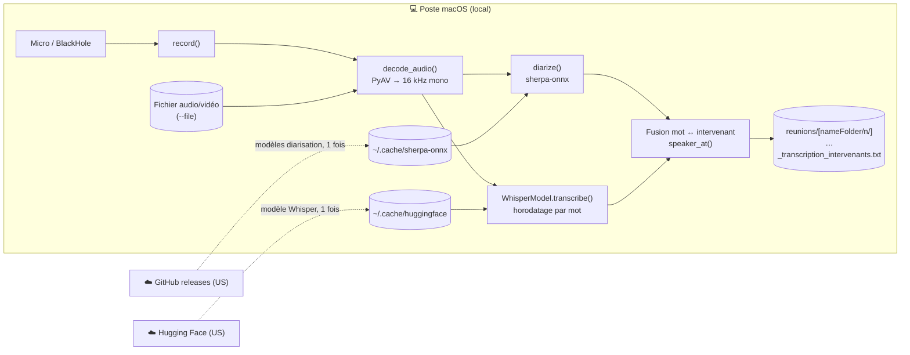

# Architecture de `script/meeting-whisper-final.py`

> Scripts voisins : [meeting-agent](architecture-meeting-agent.md) (résumé par Claude) · [meeting-whisper](architecture-meeting-whisper.md) (transcription simple)

Transcription de réunion **100 % locale avec identification des intervenants** (`Utilisateur 1`, `Utilisateur 2`…). Whisper produit le texte, sherpa-onnx sépare les voix, et le script associe les deux mot par mot. **Aucun appel à Claude.**

> **En une phrase :** ni l'audio ni le texte ne quittent le poste. Le réseau ne sert qu'à télécharger les modèles au premier lancement (Hugging Face pour Whisper, GitHub pour la diarisation).

---

## Lancer le script

```bash
# Chemin relatif (depuis le dossier local-meeting-transcriber)
cd <DOSSIER_PARENT>/local-meeting-transcriber
python3 ./script/meeting-whisper-final.py --list                                                   # liste les micros
HF_HUB_OFFLINE=1 python3 ./script/meeting-whisper-final.py --device "MacBook Air Microphone" --speakers 4 --nameFolder projetX
HF_HUB_OFFLINE=1 python3 ./script/meeting-whisper-final.py --file ./reunions/2026-11-17_1257.wav --speakers 2 --nameFolder projetX

# Chemin absolu (depuis n'importe où)
python3 <DOSSIER_PARENT>/local-meeting-transcriber/script/meeting-whisper-final.py --list
HF_HUB_OFFLINE=1 python3 <DOSSIER_PARENT>/local-meeting-transcriber/script/meeting-whisper-final.py --device "MacBook Air Microphone" --speakers 4 --nameFolder projetX
HF_HUB_OFFLINE=1 python3 <DOSSIER_PARENT>/local-meeting-transcriber/script/meeting-whisper-final.py --file <DOSSIER_PARENT>/local-meeting-transcriber/reunions/2026-11-17_1257.wav --speakers 2 --nameFolder projetX
```

`<DOSSIER_PARENT>` = le chemin du dossier **qui contient** `local-meeting-transcriber` (par exemple `/Users/<ton-utilisateur>/Downloads`). Remplace-le, chevrons compris. `reunions/` (et donc `reunions/<nameFolder>/<n>/`) est créé **dans le dossier courant** : lance le script depuis `local-meeting-transcriber` pour y retrouver tes fichiers.

---

## 1. Vue d'ensemble



---

## 2. Étapes du traitement

| # | Fonction | Ce qu'elle fait | Composants |
|---|---|---|---|
| 1 | `output_folder()` | `reunions/` par défaut. Avec `--nameFolder X`, crée `reunions/X/<n>/`, où n = le plus grand numéro existant + 1. Refuse les noms contenant `/` ou `..` | Python standard |
| 2 | `record()` | Enregistre le micro choisi jusqu'au Ctrl+C. Ignoré avec `--file`, auquel cas le fichier est copié dans le dossier si `--nameFolder` est utilisé | `sounddevice`, `soundfile` |
| 3 | `decode_audio()` | Convertit l'entrée (wav, mp4, m4a…) en 16 kHz mono | PyAV (via `faster-whisper`) |
| 4 | `fetch_models()` | Télécharge les modèles de diarisation s'ils sont absents | `urllib`, `tarfile` |
| 5 | `diarize()` | Découpe l'audio en tours de parole et regroupe les voix similaires. Utilise tous les cœurs CPU | sherpa-onnx : segmentation pyannote 3.0 (ONNX), empreinte vocale WeSpeaker ResNet34 (VoxCeleb), regroupement `FastClustering` |
| 6 | `transcribe()` | Transcription en français avec horodatage **par mot** | `faster-whisper`, VAD Silero |
| 7 | `speaker_at()` + regroupement | Attribue chaque mot à l'intervenant qui parle à cet instant, puis regroupe les mots consécutifs d'un même intervenant en une réplique. Les intervenants sont numérotés dans leur ordre d'apparition | Python standard |

### Paramètres de diarisation

| Option | Effet | Recommandation |
|---|---|---|
| `--speakers N` | Impose N intervenants, et le seuil est alors ignoré | **À privilégier** si le nombre de participants est connu |
| `--threshold` (0,5) | En mode automatique : plus bas = plus d'intervenants | Ajuster par pas de 0,1 |

Mesure sur un dialogue de test à 2 voix : 0,1 donne **3** intervenants (une voix coupée en deux), 0,3 à 0,5 en donnent **2** (correct), et 0,7 ou plus en donne **1** (voix fusionnées).

---

## 3. Services externes

| Service | Juridiction | Quand | Ce qui est transmis | Données de réunion ? |
|---|---|---|---|---|
| Hugging Face Hub | 🇺🇸 | 1er lancement pour chaque taille de modèle Whisper | IP, user-agent, nom du modèle | Non |
| **GitHub releases** (`k2-fsa/sherpa-onnx`) | 🇺🇸 (Microsoft) | 1er lancement : environ 7 Mo (segmentation) et 26 Mo (empreinte vocale) | IP, user-agent | Non |
| PyPI / Homebrew | 🇺🇸 | Installation | IP, liste des paquets | Non |

`HF_HUB_OFFLINE=1` bloque Hugging Face. Il n'existe pas d'équivalent pour GitHub, mais le script ne le contacte pas si les modèles sont déjà dans `~/.cache/sherpa-onnx`.

---

## 4. Données stockées localement

| Emplacement | Contenu |
|---|---|
| `reunions/[<nameFolder>/<n>/]*.wav` | Audio brut, voix des participants |
| `…_transcription_intervenants.txt` | Transcription attribuée par intervenant |
| `~/.cache/huggingface/`, `~/.cache/sherpa-onnx/` | Modèles, aucune donnée personnelle |

Remarque RGPD : les **empreintes vocales** calculées pendant la diarisation restent en mémoire et ne sont jamais écrites sur le disque. Le script n'identifie pas les personnes : il ne fait que distinguer les voix entre elles.

---

## 5. Souveraineté : points restants

1. **Information des participants**, obligatoire (RGPD).
2. **Conservation locale** sans purge automatique.
3. **Modèles non épinglés et téléchargés sans vérification d'intégrité** : pas de hash contrôlé sur les fichiers GitHub, pas de `revision=` pour Whisper. En environnement contrôlé, il faut fournir les modèles depuis un dépôt interne validé.

## 6. Performances et limites (mesurées sur MacBook Air)

- Diarisation : environ **40 s pour 3 min d'audio**, soit environ 15 min pour 1 h, auxquelles s'ajoute la transcription.
- Fiabilité réduite quand des personnes parlent en même temps ou que le micro est éloigné. Un débat est plus difficile qu'une réunion.
- Le modèle d'empreinte vocale est entraîné sur VoxCeleb (majoritairement en anglais). Il fonctionne sur le français, mais n'a pas été spécialement optimisé pour cette langue.
