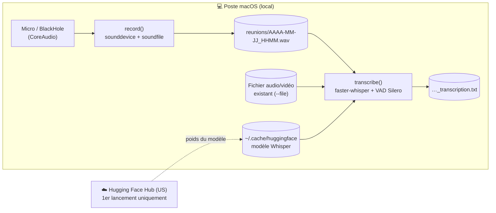

# Architecture de `script/meeting-whisper.py`

> Scripts voisins : [meeting-agent](architecture-meeting-agent.md) (résumé par Claude) · [meeting-whisper-final](architecture-meeting-whisper-final.md) (avec intervenants)

Transcription de réunion **100 % locale**. Le script enregistre l'audio, ou lit un fichier existant, et le transcrit avec Whisper. **Aucun appel à Claude ni à un autre service d'IA.**

> **En une phrase :** ni l'audio ni le texte ne quittent le poste. Le seul accès réseau est le téléchargement unique du modèle Whisper.

---

## Lancer le script

```bash
# Chemin relatif (depuis le dossier local-meeting-transcriber)
cd <DOSSIER_PARENT>/local-meeting-transcriber
python3 ./script/meeting-whisper.py --list                                                    # liste les micros
HF_HUB_OFFLINE=1 python3 ./script/meeting-whisper.py --device "MacBook Air Microphone"        # Ctrl+C pour arrêter
HF_HUB_OFFLINE=1 python3 ./script/meeting-whisper.py --file ./reunions/2026-11-17_1257.wav    # fichier existant

# Chemin absolu (depuis n'importe où)
python3 <DOSSIER_PARENT>/local-meeting-transcriber/script/meeting-whisper.py --list
HF_HUB_OFFLINE=1 python3 <DOSSIER_PARENT>/local-meeting-transcriber/script/meeting-whisper.py --device "MacBook Air Microphone"
HF_HUB_OFFLINE=1 python3 <DOSSIER_PARENT>/local-meeting-transcriber/script/meeting-whisper.py --file <DOSSIER_PARENT>/local-meeting-transcriber/reunions/2026-11-17_1257.wav
```

`<DOSSIER_PARENT>` = le chemin du dossier **qui contient** `local-meeting-transcriber` (par exemple `/Users/<ton-utilisateur>/Downloads`). Remplace-le, chevrons compris. En mode enregistrement, les fichiers sont écrits dans `reunions/` **du dossier courant**. Avec `--file`, la transcription est écrite à côté du fichier audio.

---

## 1. Vue d'ensemble



---

## 2. Étapes du traitement

| # | Fonction | Ce qu'elle fait | Composants | Données envoyées ? |
|---|---|---|---|---|
| 1 | `record()` | Capture le périphérique choisi (`--device`) en mono 16 kHz jusqu'au Ctrl+C. Étape ignorée avec `--file` | `sounddevice` (PortAudio → CoreAudio), `soundfile` (libsndfile) | Non |
| 2 | `transcribe()` | Transcrit en français et affiche chaque segment horodaté au fil de l'eau | `faster-whisper` (CTranslate2, CPU), modèle `Systran/faster-whisper-<taille>`, VAD Silero (ONNX, fourni avec le paquet), PyAV (décodage) | **Non** |
| 3 | `main()` | Écrit `reunions/<horodatage>_transcription.txt`, ou `<fichier>_transcription.txt` à côté du fichier passé avec `--file` | Python standard | Non |

---

## 3. Services externes

| Service | Juridiction | Quand | Ce qui est transmis | Données de réunion ? |
|---|---|---|---|---|
| Hugging Face Hub | 🇺🇸 | 1er lancement pour chaque taille de modèle (`--model`) | IP, user-agent, nom du modèle | Non |
| PyPI / Homebrew | 🇺🇸 | Installation | IP, liste des paquets | Non |

`HF_HUB_OFFLINE=1` bloque tout accès à Hugging Face une fois le modèle en cache. Le script n'a alors besoin d'aucun service externe (testé avec `HF_HUB_OFFLINE=1`).

---

## 4. Données stockées localement

| Emplacement | Contenu |
|---|---|
| `reunions/*.wav` | Audio brut, sans durée de conservation, non chiffré |
| `reunions/*_transcription.txt` | Transcription horodatée, non chiffrée |
| `~/.cache/huggingface/` | Poids du modèle, aucune donnée personnelle |

---

## 5. Souveraineté : points restants

Le flux vers un fournisseur d'IA a disparu. Il reste :
1. **Information des participants** : elle reste obligatoire (RGPD), même si tout est traité en local.
2. **Conservation locale** : l'audio et le texte s'accumulent sans purge. Il faut définir une durée de conservation et éviter les dossiers synchronisés (iCloud, OneDrive).
3. **Chaîne d'approvisionnement** : le modèle n'est pas épinglé sur une version (pas de `revision=`), et les dépendances PyPI ne sont pas verrouillées.

## 6. Limites

- Pas d'identification des intervenants. Pour ça, voir [meeting-whisper-final](architecture-meeting-whisper-final.md).
- `faster-whisper` n'utilise que le processeur sur Mac. Des alternatives comme `mlx-whisper` ou `whisper.cpp` exploitent la puce graphique Apple et seraient plus rapides.
